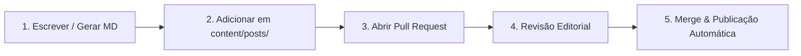

# Maltese — Caderno de Escritos, Crítica & Liberdade

Um site editorial independente, estático e moderno, construído com **Next.js**, **Tailwind CSS** e **Markdown**, projetado especialmente para publicação de ensaios, manifestos e textos literários com **zero banco de dados** e hospedagem **100% gratuita** (Vercel, GitHub Pages, Cloudflare Pages ou Netlify).

---

## Destaques & Estética

- **Estética Editorial & Libertária:** Inspirada na tradição dos manifestos, prensas clássicas e periódicos de resistência intelectual.
- **3 Modos de Leitura (Temas):**
  - **Papel & Prensa Clássico:** Tons quentes de papel envelhecido e detalhes em vermelho carmesim.
  - **Sépia Livro Antigo:** Tons terrosos de biblioteca e conforto visual prolongado.
  - **Noturno Revolucionário:** Carvão e contraste refinado para leituras noturnas.
- **Zero Banco de Dados:** Todos os seus textos são arquivos `.md` na pasta `content/posts/`. Você tem soberania total sobre seus escritos.
- **Ferramentas do Leitor:**
  - Barra de progresso de leitura no topo.
  - Controle dinâmico do tamanho da fonte (A- / A+ / A++).
  - Marcador de leitura local (*Salvar para ler depois* sem login).
  - Cópia instantânea de citação formatada (ABNT / Referência acadêmica).
  - Impressão otimizada & Salvar em PDF limpo.
- **Pesquisa & Filtros Interativos:** Busca em tempo real por palavras-chave, categorias e tags.
- **SEO & Distribuição:** RSS Feed nativo (`/rss.xml`), Sitemap automatizado (`/sitemap.xml`) e OpenGraph tags para compartilhamento em redes sociais.

---

## Como Rodar Localmente

1. Certifique-se de ter o **Node.js** instalado (v18+).
2. Instale as dependências:
   ```bash
   npm install
   ```
3. Inicie o servidor de desenvolvimento:
   ```bash
   npm run dev
   ```
4. Abra no seu navegador: [http://localhost:3000](http://localhost:3000)

---

## Como Adicionar Novos Textos

Para publicar um novo texto, basta criar um arquivo `.md` dentro da pasta `content/posts/`.

Exemplo: `content/posts/meu-novo-ensaio.md`

```markdown
---
title: "Título do Seu Novo Ensaio ou Crônica"
slug: "meu-novo-ensaio"
date: "2026-03-28"
summary: "Um resumo conciso de uma ou duas frases sobre a ideia central do texto."
category: "Ensaios" # Opções sugeridas: Ensaios, Manifestos, Crítica Social, Poesia & Fragmentos, Filosofia
tags: ["Liberdade", "Crítica", "Pensamento"]
readingTime: "5 min"
featured: false # Mude para true para destacar na página inicial
epigraph: "Uma citação inspiradora que abre o texto. — Nome do Autor"
author: "Maltese"
---

## Primeiro Subtítulo

Escreva seu texto livremente em Markdown. Você pode usar:

* **Negrito** para enfatizar ideias centrais;
* *Itálico* para conceitos sutis;
* Listas ordenadas e não ordenadas;

> "Citações ganham automaticamente uma barra lateral em carmesim e tipografia destacada."

Adicione quantos subtítulos e seções desejar!
```

---

## Como Subir e Usar de Graça (Deploy na Vercel)

A **Vercel** oferece hospedagem estática e serverless com SSL gratuito, CDN global ultrarrápida e atualizações automáticas a cada novo texto adicionado.

1. **Suba seu projeto no GitHub:**
   ```bash
   git init
   git add .
   git commit -m "Meu caderno de textos"
   git branch -M main
   git remote add origin https://github.com/SEU-USUARIO/SEU-REPOSITORIO.git
   git push -u origin main
   ```

2. **Conecte na Vercel:**
   - Acesse [vercel.com](https://vercel.com) e faça login gratuito com sua conta do GitHub.
   - Clique em **"Add New..."** > **"Project"**.
   - Selecione o repositório que você acabou de subir.
   - O Next.js será detectado automaticamente. Clique em **"Deploy"**.

3. **Pronto!** Seu site estará no ar em um link gratuito (ex: `salomao.vercel.app`) ou no seu próprio domínio personalizado caso você tenha um. Toda vez que você adicionar um novo arquivo `.md` e fizer `git push`, o site se atualiza sozinho em poucos segundos!

---

## Como Submeter Textos (Processo de publicação via Pull Request) {#submeter-texto}

O **Caderno Maltese** foi concebido como uma **plataforma de publicação aberta**. Qualquer autor(a), ensaísta ou pesquisador(a) pode submeter textos, poesias, manifestos ou reflexões diretamente através de um **Pull Request (PR)** no GitHub.

Uma vez revisado e aprovado, o merge é realizado e seu texto vai ao ar **automaticamente** no site, com seu nome, resumo e links!

### Como Funciona o Fluxo de Publicação:



---

### Pelo Navegador (Sem precisar instalar nada)

1. **Gere seu arquivo:** Acesse a página [`/gerador`](http://localhost:3000/gerador) no site, preencha o título, sinopse, categorias e o corpo do texto e clique em **"Baixar .md"**.
2. **Acesse o repositório no GitHub:** Vá até a pasta [`content/posts/`](content/posts/).
3. **Envie o arquivo:** Clique em **"Add file"** ➔ **"Upload files"** e solte o arquivo `.md` baixado.
4. **Crie a proposta de alteração:** Na parte inferior, selecione *"Create a new branch for this commit and start a pull request"*.
5. **Abra o Pull Request:** Escreva uma breve mensagem contando sobre o texto e clique em **"Propose changes"** ➔ **"Create pull request"**.
6. **Pronto!** Só aguardar a publicação.

---

### Diretrizes de publicação:
- **Temas acolhidos:** Ensaios sociais, crítica política, reflexões filosóficas, memórias, manifestos, crônicas e poesias que dialoguem com a emancipação humana e o pensamento crítico.
- **Linha ética inegociável:** Repúdio absoluto a qualquer forma de discurso de ódio, preconceito, intolerância ou desumanização.
- **Licença livre:** Todo texto aprovado é distribuído sob licença livre Copyleft, garantindo que o conhecimento permaneça aberto e acessível a todos.

---


## Licença
Distribuído sob licença livre **Copyleft (ɔ) 2026**. Todo o conhecimento é livre para debate, reprodução e difusão solidária.
